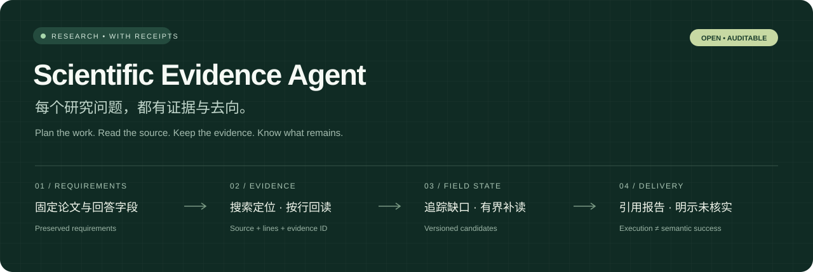
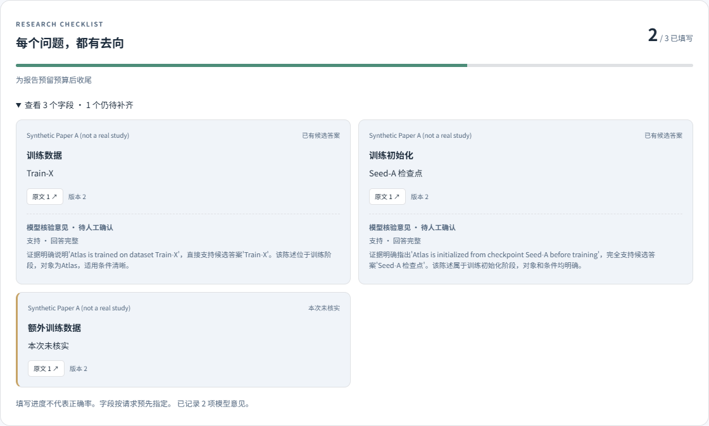
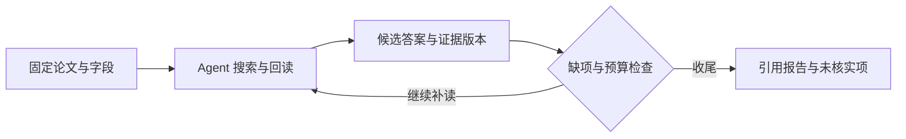

<p align="center">
  
</p>

<p align="center">
  <a href="https://github.com/wubuxy/scientific-evidence-agent/actions/workflows/ci.yml"></a>
  
  
  
</p>

<p align="center">
  <a href="#快速开始">快速开始</a> ·
  <a href="docs/DEMO.md">五分钟演示</a> ·
  <a href="docs/FIELD_STATE.md">字段状态设计</a> ·
  <a href="docs/DEEP_RESEARCH_READING_GUIDE.md">Deep Research 阅读路线</a> ·
  <a href="docs/EVALUATION.md">实验与局限</a>
</p>

**一个为科研文献调研设计的证据 Agent。** 从用户要求拆出论文字段，自主搜索、按行阅读，保存带版本的候选答案；在预算内补齐缺项，交付能追溯原文、明确标注未核实内容的报告。

> 比较这些论文的训练数据、初始化方式和评测条件。每项结论给出原文依据；找不到的部分保留缺口。

## 看见 Agent 的工作



<sub>真实工作台组件，展示一次真实模型调用的合成资料接通检查。用于说明交互，不是科研准确率结果。</sub>

| 问题变成要求 | 行动留下依据 | 缺口有明确去向 |
|---|---|---|
| 固定论文与字段，计划不能删除已有要求 | 搜索负责定位，实际回读产生本次可用 evidence ID | 区分未填写、未核实、候选答案与模型核验意见 |
| 候选答案与原文版本绑定 | 每条引用可追到来源、行号与工具记录 | 有限补读只补缺项，保留已有内容与失败记录 |

工作台新任务默认启用字段跟踪和有界补读，可在研究设置切换为仅观察或关闭。**填写进度不代表正确率；语义核验仍待人工校准。** [完整状态、预算和接口说明 →](docs/FIELD_STATE.md)

## 一个受约束的研究循环



- **模型选择行动**：查询词、阅读范围、候选答案与交付时机。
- **程序守住约束**：本次回读引用、要求保留、字段版本、修复范围及 token / 步数 / 时间预算。
- **独立评测检查效果**：生产 Runtime 生成报告，参考答案只进入评分；失败保留在分母，核验调用计入成本。

Grep、BM25＋向量 RRF、SQLite 证据存储和 React 工作台复用同一组服务。[架构与代码映射 →](docs/ARCHITECTURE.md)

## 已验证什么

| 证据 | 当前结论 |
|---|---|
| 字段状态与局部补救 | 生产循环测试覆盖版本失效、缺项补救、保留已有内容、预算与访问隔离；附[真实模型接通与验证记录](docs/results/FIELD_STATE_V1.md) |
| 完整报告评测 | 12 篇新开发论文、16 份真实报告、184 条双模型核验记录；92 条自然声明等待两人独立标注 |
| 五组修复对照 | 20 题 × 2 次上游 × 5 策略；定向补读相对普通补搜 **+3.91pp F1，95% CI [−6.01, +16.27]pp**，尚未确认优势 |
| 可复现交付 | Linux / Windows 后端、前端类型检查与构建、Docker 导入与持久化均由 CI 验证 |

我们目前能展示可审计的执行和评测工具链。字段控制器的质量收益、运行时 skill 和经验更新仍需新论文上的对照，不能从工具调用成功或模型自评推出。

<details>
<summary><strong>展开历史实验、训练结果与复现范围</strong></summary>

| 验证项目 | 已完成内容 |
|---|---|
| 自动化回归 | **完整依赖环境下 228 项离线测试通过**，覆盖科研流程、五组对照、缓存回放、完整报告、字段版本与补救、盲审页面、数据隔离与模型生命周期；依赖与跳过口径见[复现说明](docs/REPRODUCIBILITY.md) |
| 应用交付 | TypeScript 检查与前端构建通过，真实模型完整报告接口验证完成 |
| 数据准备 | QASPER 开发 50 题、留出测试 200 题，版本与哈希固定，论文划分隔离 |
| 方法对照 | **36 道独立开发题、96 次完整上游任务运行**，覆盖四种检索配置与新论文检查 |
| 上下文研究 | 完成 **330 次固定回读作答对照**；支持按行选择、局部 BM25 与任务级配对分析 |
| 证据复核 | 实现声明支持候选判定与行号依据；**16 条合成正反例**基础检查通过 |
| 定向回读 | 实现 **6 题三组受控对照**，分离原始答案、复核重答与补读重答；记录统一预算与实际调用费用 |
| 补读重复实验 | 复用开发池 **20 题 × 2 次上游 × 5 策略＝200 结果**；定向补读相对普通补搜 F1 +3.91pp，95% 区间 [−6.01, +16.27]pp，未确认优势；另完成 40 条核验触发回放，见[结果与诊断](docs/results/REPAIR_FIVE_ARM_DEV20_V1.md) |
| 自然报告评测 | 新选 **12 篇论文、16 份生产 Runtime 报告、184 次双模型核验**，生成 92 条自然声明的独立盲审包；人工标签待返回，语义准确率未产生，见[报告与交付](docs/results/REPORT_CALIBRATION_V1.md) |
| 单卡核验器研究 | A5000 上完成 **1.5B/7B 双精度、三种子 BF16 LoRA 与 MiniCheck** 对照；原始 gold 的新 128 对测试上 7B macro F1 0.581→平均 0.746，但支持精确率门槛未通过，见[完整结果](docs/results/SCIFACT_VERIFIER_SCALE_V2.md)及后续[标签与误判诊断](docs/results/VERIFIER_DATA_DIAGNOSIS.md) |
| 标签干预对照 | **六次新训练、1,446 条预测**：仅改 7/535 条训练标签，原始口径平均 F1 0.748→0.743；两种评分口径均未观察到稳定收益，见[全部结果与配对区间](docs/results/SCIFACT_LABEL_ABLATION_V1.md) |

</details>

## 快速开始

**无需模型密钥，先看历史真实轨迹回放：**

```bash
docker compose up --build -d --wait
```

打开[本地演示 http://127.0.0.1:5183/demo](http://127.0.0.1:5183/demo)，从结论点进 evidence ID、原文行号和工具轨迹，再查看一个失败案例。示例论文可以导入工作台。`/demo` 回放不调用模型；`/` 新研究需要配置自己的模型服务。Docker Compose 需要 2.24+。

[演示脚本、配置与数据持久化 →](docs/DEMO.md)

<details>
<summary><strong>本机开发：Python / Node / 模型配置</strong></summary>

需要 **Python 3.10+、Node.js 20.19+ 或 22.12+**，以及加入 PATH 的 [ripgrep](https://github.com/BurntSushi/ripgrep)。以下以 PowerShell 为例。

Windows 可通过 `winget install BurntSushi.ripgrep.MSVC` 安装 ripgrep，Ubuntu/Debian 使用 `sudo apt-get install ripgrep`，macOS 使用 `brew install ripgrep`。安装后运行 `rg --version` 检查；Windows 可能需要重新打开终端。

**① 启动后端**

```powershell
cd backend
python -m venv .venv
.\.venv\Scripts\Activate.ps1
python -m pip install -r requirements-research.txt -c constraints-ci.txt
$env:PYTHONPATH = 'app'
python -m research_backend.cli init
```

在生成的 `.env.research` 中填写 `RESEARCH_LLM_API_KEY`。初始化命令会生成随机 JWT 密钥，并保留已有配置。主要配置如下：

```dotenv
RESEARCH_LLM_BASE_URL=https://dashscope.aliyuncs.com/compatible-mode/v1
RESEARCH_LLM_MODEL=qwen3.5-27b
RESEARCH_LLM_EXTRA_BODY={"enable_thinking":false}
RESEARCH_RAG_BACKEND=local
RESEARCH_EMBEDDING_MODEL=text-embedding-v4
```

使用混合检索时设置 `RESEARCH_RAG_ENABLED=true`，然后启动服务：

```powershell
python -m uvicorn research_main:app --app-dir app --env-file .env.research --host 127.0.0.1 --port 8001
```

**② 启动工作台**

```powershell
cd frontend
npm ci
npm run dev
```

打开[本地工作台 http://127.0.0.1:5183](http://127.0.0.1:5183)，创建工作区、导入论文并提出研究问题。默认启动方式面向本机使用；开发网关在 Node 进程内签发访问令牌，密钥保存在后端配置中。

Linux/macOS 对应使用 `source .venv/bin/activate` 和 `export PYTHONPATH=app`。Grep 与原文阅读可独立使用；模型和 embedding 调用使用云端 API。

<details>
<summary><strong>运行测试与可选分析功能</strong></summary>

```powershell
cd backend
python -m pytest tests -q
python -m pytest tests -q --without-rg
cd ../frontend
npm ci
npm run build
```

离线测试使用可替换模型，不调用付费 API。`requirements-research.txt` 提供科研主线最小依赖；统计分析与 XLSX 支持见 `backend/requirements-analysis.txt`，LSTM 扩展见 `backend/requirements-analysis-lstm.txt`。缺少可选依赖时仅跳过对应测试，pytest 会显示原因。

GitHub Actions 配置覆盖 Linux / Windows、Python 3.10 / 3.13、核心与完整依赖，以及 Node 24 前端构建。安装命令、测试矩阵和结果口径见[复现说明](docs/REPRODUCIBILITY.md)。

</details>

</details>

## 沿着问题读代码和论文

| 想了解什么 | 从这里开始 |
|---|---|
| Deep Research 大家在做什么，做到哪了 | [阅读路线与评测地图](docs/DEEP_RESEARCH_READING_GUIDE.md) |
| Agent 如何判断缺项、控制修复和停止 | [字段状态与有界补救](docs/FIELD_STATE.md) |
| 检索、回读、证据和上下文如何协作 | [技术设计](docs/ARCHITECTURE.md) |
| 哪些实验支持结论，哪些仍未验证 | [验证成果](docs/EVALUATION.md) · [报告校准](docs/results/REPORT_CALIBRATION_V1.md) |
| 如何复算结果和运行对照 | [复现环境](docs/REPRODUCIBILITY.md) · [评测命令](docs/BENCHMARKS.md) |
| Skill / 经验更新为什么还需要可信反馈 | [后续路线](docs/AGENT_SKILLS_AND_EVOLUTION.md) |

```text
backend/app/research_backend/
  runtime.py          模型工具循环、预算、报告交付
  field_state.py      字段要求、候选版本、局部补救与核验记录
  tools.py            检索与阅读接口
  benchmarks/         冻结数据、完整轨迹、独立评分与训练对照
frontend/src/research/ 文献工作台、字段进度、原文检查与回放
backend/tests/        离线回归与完整执行场景
docs/                 设计、阅读指南、协议与实验结果
```

运行配置、密钥、原始语料与本地数据库不进入仓库。历史回放与合成界面展示均明确标注来源；研究效果以对应实验协议和结果为准。
