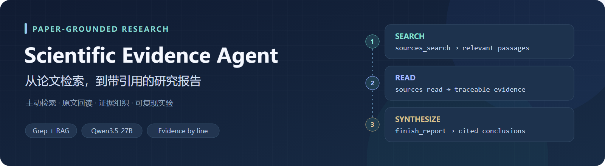
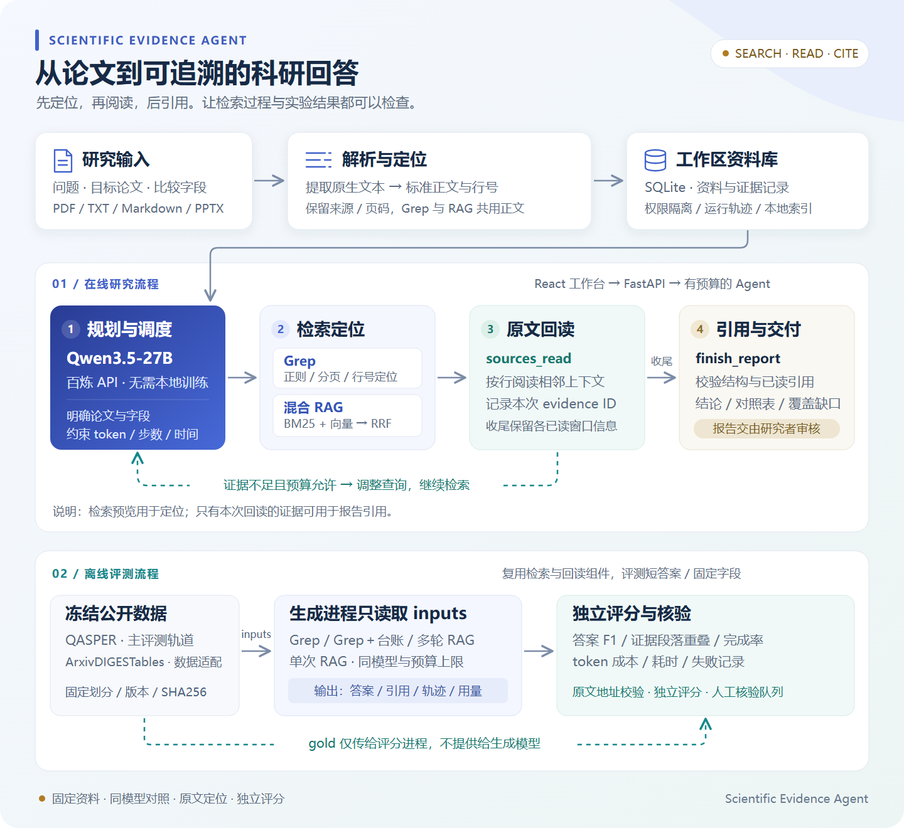
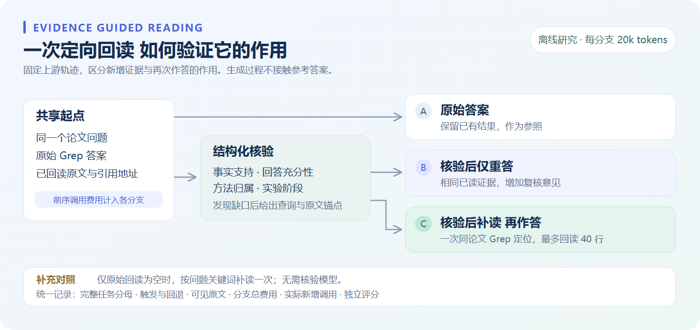

<p align="center">
  
</p>

<p align="center">
  
  
  
  
</p>

<p align="center">
  <a href="#快速开始">快速开始</a> ·
  <a href="docs/DEMO.md">五分钟演示</a> ·
  <a href="docs/ARCHITECTURE.md">技术设计</a> ·
  <a href="docs/EVALUATION.md">验证成果</a> ·
  <a href="docs/BENCHMARKS.md">复现实验</a>
</p>

**Scientific Evidence Agent** 是面向科研文献调研的证据驱动助手。它围绕问题主动检索论文、按行阅读上下文，组织原文证据并生成带引用的结论与对照表。

> “比较这些论文的训练数据、模型训练方式和实验条件，并给出对应的原文依据。”

项目同时提供 **React 文献工作台、FastAPI 科研服务和独立评测工具链**，使用百炼 Qwen3.5-27B API 完成推理。

## 核心能力

| 🔎 主动检索 | 📖 精确回读 | 🔗 引用交付 |
|---|---|---|
| Grep 正则定位、多轮查询与分页；支持 BM25＋向量混合检索 | 按来源与行号读取原文，保留页码、证据 ID 和完整工具轨迹 | 输出结构化结论、论文对照表、原文引用与任务覆盖情况 |

| 🧠 证据上下文 | 🗂️ 文献工作区 | 🧪 可复现实验 |
|---|---|---|
| 已读窗口保留、字段摘录、按问题选择片段；支持独立策略对照 | PDF、TXT、Markdown、PPTX 导入；SQLite 持久化与工作区隔离 | 数据冻结、生成与参考答案隔离、独立评分、配对分析和用量记录 |

## 系统设计

[](docs/assets/research-workflow.svg)

研究流程以 **Search → Read → Synthesize** 为核心。检索返回可回读地址，阅读产生本次运行的证据记录，报告校验引用归属后交付。模型运行受 token、步数和时间预算约束。

评测流程复用同一套检索与阅读组件，支持单次混合 RAG、多轮 RAG、多轮 Grep 和字段证据策略。参考答案仅进入独立评分程序。实现映射见 [技术设计](docs/ARCHITECTURE.md)。

## 验证成果

| 验证项目 | 已完成内容 |
|---|---|
| 自动化回归 | **完整依赖环境下 177 项离线测试通过**，覆盖科研流程、演示资料、五组对照、完整报告、标注校准、数据隔离与模型生命周期；依赖与跳过口径见[复现说明](docs/REPRODUCIBILITY.md) |
| 应用交付 | TypeScript 检查与前端构建通过，真实模型完整报告接口验证完成 |
| 数据准备 | QASPER 开发 50 题、留出测试 200 题，版本与哈希固定，论文划分隔离 |
| 方法对照 | **36 道独立开发题、96 次完整上游任务运行**，覆盖四种检索配置与新论文检查 |
| 上下文研究 | 完成 **330 次固定回读作答对照**；支持按行选择、局部 BM25 与任务级配对分析 |
| 证据复核 | 实现声明支持候选判定与行号依据；**16 条合成正反例**基础检查通过 |
| 定向回读 | 实现 **6 题三组受控对照**，分离原始答案、复核重答与补读重答；记录统一预算与实际调用费用 |
| 单卡核验器研究 | A5000 上完成 **1.5B/7B 双精度、三种子 BF16 LoRA 与 MiniCheck** 对照；原始 gold 的新 128 对测试上 7B macro F1 0.581→平均 0.746，但支持精确率门槛未通过，见[完整结果](docs/results/SCIFACT_VERIFIER_SCALE_V2.md)及后续[标签与误判诊断](docs/results/VERIFIER_DATA_DIAGNOSIS.md) |

验证覆盖科研工作流、检索问答与证据上下文三个层次。数据范围、指标定义及实验配置见 [验证成果](docs/EVALUATION.md)，运行命令见 [复现实验](docs/BENCHMARKS.md)。

自动评测支持固定计划、完整轨迹重复、五组补读对照、工作台实际 Runtime、联合证据判定和双人标注校准；失败保留在分母，实际共享费用与策略独立成本分别记录。运行命令、评分边界与小模型训练条件见 [Agent 自动评测与训练路线](docs/AGENT_EVAL_AND_TRAINING.md)。

**研究闭环：发现证据缺口 → 定向搜索 → 一次原文回读 → 带引用重答。** 离线实验同时保留仅重答和关键词补读对照，便于区分新增证据与额外模型调用的作用。

<details>
<summary><strong>查看核验回读实验设计</strong></summary>



</details>

## 快速开始

**Docker 本地演示（无需模型密钥）**

```powershell
docker compose up --build -d --wait
```

打开 **http://127.0.0.1:5183/demo**，查看一份真实报告的结论、原始工具轨迹、证据 ID 与原文，再检查一个真实失败案例。点击“用示例论文开始研究”可将两篇 CC BY 4.0 论文导入工作台。回放不调用模型；新生成需配置自己的模型服务。

启动、模型配置、数据保存与五分钟讲解脚本见 [演示说明](docs/DEMO.md)。Docker Compose 需要 2.24+，本机手动开发方式如下。

需要 **Python 3.10+、Node.js 20.19+ 或 22.12+**，以及加入 PATH 的 [ripgrep](https://github.com/BurntSushi/ripgrep)。以下以 PowerShell 为例。

Windows 可通过 `winget install BurntSushi.ripgrep.MSVC` 安装 ripgrep，Ubuntu/Debian 使用 `sudo apt-get install ripgrep`，macOS 使用 `brew install ripgrep`。安装后运行 `rg --version` 检查；Windows 可能需要重新打开终端。

**① 启动后端**

```powershell
cd backend
python -m venv .venv
.\.venv\Scripts\Activate.ps1
python -m pip install -r requirements-research.txt -c constraints-ci.txt
$env:PYTHONPATH = 'app'
python -m research_backend.cli init
```

在生成的 `.env.research` 中填写 `RESEARCH_LLM_API_KEY`。初始化命令会生成随机 JWT 密钥，并保留已有配置。主要配置如下：

```dotenv
RESEARCH_LLM_BASE_URL=https://dashscope.aliyuncs.com/compatible-mode/v1
RESEARCH_LLM_MODEL=qwen3.5-27b
RESEARCH_LLM_EXTRA_BODY={"enable_thinking":false}
RESEARCH_RAG_BACKEND=local
RESEARCH_EMBEDDING_MODEL=text-embedding-v4
```

使用混合检索时设置 `RESEARCH_RAG_ENABLED=true`，然后启动服务：

```powershell
python -m uvicorn research_main:app --app-dir app --env-file .env.research --host 127.0.0.1 --port 8001
```

**② 启动工作台**

```powershell
cd frontend
npm ci
npm run dev
```

打开 **http://127.0.0.1:5183**，创建工作区、导入论文并提出研究问题。默认启动方式面向本机使用；开发网关在 Node 进程内签发访问令牌，密钥保存在后端配置中。

Linux/macOS 对应使用 `source .venv/bin/activate` 和 `export PYTHONPATH=app`。Grep 与原文阅读可独立使用；模型和 embedding 调用使用云端 API。

<details>
<summary><strong>运行测试与可选分析功能</strong></summary>

```powershell
cd backend
python -m pytest tests -q
python -m pytest tests -q --without-rg
cd ../frontend
npm ci
npm run build
```

离线测试使用可替换模型，不调用付费 API。`requirements-research.txt` 提供科研主线最小依赖；统计分析与 XLSX 支持见 `backend/requirements-analysis.txt`，LSTM 扩展见 `backend/requirements-analysis-lstm.txt`。缺少可选依赖时仅跳过对应测试，pytest 会显示原因。

GitHub Actions 配置覆盖 Linux / Windows、Python 3.10 / 3.13、核心与完整依赖，以及 Node 24 前端构建。安装命令、测试矩阵和结果口径见[复现说明](docs/REPRODUCIBILITY.md)。

</details>

## 技术参考

项目将文件式主动检索、结果交付、上下文选择和分层证据评测思想应用于科研文献场景：

- [Coding Agents are Effective Long-Context Processors](https://arxiv.org/html/2603.20432v1)：可导航资料与迭代处理。
- [Is Grep All You Need?](https://arxiv.org/html/2605.15184v1)：检索方式与 Agent 执行框架的配合。
- [HiEviDR-Bench](https://arxiv.org/html/2607.25151)：证据、断言与结论的分层检查。
- [Context Engineering Starts with Retrieval](https://www.langchain.com/blog/context-engineering-starts-with-retrieval)：按需读取和上下文组织。

## 项目结构

```text
backend/app/research_backend/             科研服务、检索、证据与报告
backend/app/research_backend/benchmarks/  数据准备、受控实验与独立评分
backend/tests/                           离线回归测试
frontend/src/research/                   文献工作台
docs/ARCHITECTURE.md                     设计与实现映射
docs/EVALUATION.md                       验证成果与实验范围
docs/BENCHMARKS.md                       数据协议与复现命令
```

源码、最小依赖、测试及复现说明随仓库发布。运行配置、数据库、下载语料和详细实验记录由本地工作目录管理。
