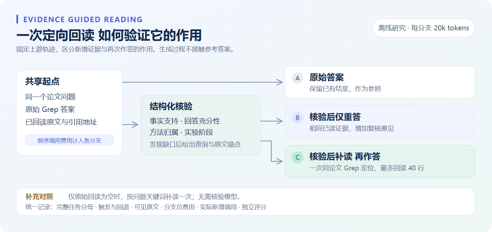

# 验证成果

项目同时提供可运行的科研工作台与可复现的实验工具。以下记录截至 2026-11-07 已完成的验证。Agent 主模型为百炼 `qwen3.5-27b`，通过 API 推理；本地核验器研究使用 Qwen2.5-1.5B/7B 和 MiniCheck，与完整 Agent 任务分开统计。

## 工程验证

| 层次 | 验证内容 |
|---|---|
| 自动化回归 | **完整依赖环境下 230 项离线测试通过**：科研 API、引用约束、字段版本与局部补救、公开回放完整性、模型与预算控制、重复评测、缓存回放、完整报告、盲审页面、格式恢复、训练隔离与模型释放；依赖与跳过口径见[复现说明](REPRODUCIBILITY.md) |
| 字段控制器 | 不可删除的要求、候选版本绑定、缺项局部修复、失败检查点和观察性核验已接入生产 Runtime；合成资料真实模型检查 2/3 字段已填写、1 项未核实，不计准确率，见[验证记录](results/FIELD_STATE_V1.md) |
| 前端交付 | TypeScript 检查、Vite 生产构建通过 |
| 字段回放 | 无需密钥的四视图回放，原文/版本/成本与合成接通记录对齐；深浅主题与移动视口通过浏览器检查，16 秒动图来自真实页面，见[素材来源](SHOWCASE.md) |
| 本地演示 | Docker 镜像构建、健康启动、两篇论文导入、真实 Grep、JWT 代理与重启持久化检查通过；历史回放与新生成入口分开 |
| 自动评测编排 | 固定计划、全轨迹重复、五组配对分支、生产报告 Runtime、联合证据判定、双人标注校准、失败分母与未知成本检查通过；本地假模型完成实际 CLI 验收，不增加真实质量实验规模 |
| 真实调用 | 完整研究报告接口已通过真实模型调用，覆盖读取、引用与结构化报告交付 |
| 证据地址 | 校验来源归属、已读 evidence ID、行范围；按行选择时由程序复制原文 |
| 实验留痕 | 保存输入与代码哈希、模型参数、可见工具轨迹、调用用量和独立评分结果 |

## 实验覆盖

| 实验 | 已执行规模 | 对照内容 |
|---|---|---|
| 检索方法对照 | 20 道 QASPER 开发题 × 4 种方法，共 **80 次完整任务** | Grep、字段台账、多轮混合 RAG、单次混合 RAG |
| 新论文迁移检查 | 另 10 道开发题、10 篇新论文，共 **10 次完整 Grep 任务** | 与前一组论文隔离，预先固定任务清单 |
| 固定回读上下文实验 | 两组开发题，累计 **330 次作答重放** | 头部保留、模型按行选择、局部 BM25、完整回读；3,500 / 9,000 字符预算 |
| 证据复核基础检查 | 8 组、**16 条合成对照样例** | 否定、角色、条件、阶段、指标、因果、信息缺失和时间范围；单次判定 16/16 与预设标签一致 |
| 核验驱动回读 | 再选 6 篇新论文、6 次完整 Grep，保存 **18 条分支结果** | 原始答案、复核后重答、复核后定向回读再作答；共享前序轨迹与每分支 20k 总预算 |
| 轻量补读对照 | 同 6 题的确定性规则对照 | 仅无回读时按问题关键词检索，最多增加一次 40 行原文阅读 |
| 跨模型复核 | 16 条真实声明，由另一款百炼 `qwen3.5-397b-a17b` 复核 | 保留相同输入、同一提示与全部候选意见，支持差异核查 |

固定回读实验复用检索阶段已经读取的原文，使上下文组织可以独立比较。生成过程不接触参考答案，评分过程独立读取标注。完整回读是放宽上下文的诊断条件，其预算单独标记。

上述早期实验包含 **96 次完整上游任务，覆盖 36 道独立开发题、35 篇论文**。330 次上下文作答重放和回读实验的分支记录复用其中部分题目，分别统计。核验驱动回读在单案例中完成了从缺少依据到定位结果段落、带引用作答的闭环；该模块保持为可复现的离线研究组件。

后续复用已观察开发池做了 **20 题 × 2 次全新上游 × 5 策略，共 40 条上游、200 个配对结果**。预先固定的主比较 C 定向补读 − E 普通补搜为 **+3.91pp F1，95% 区间 [−6.01, +16.27]pp**，未通过推进标准。另完成 40 条核验触发的缓存策略回放，属于事后诊断，不能增加独立样本量。两批 Windows 导入失败与恢复记录分开保留，见[全部结果](results/REPAIR_FIVE_ARM_DEV20_V1.md)。这些题不计为 20 道新的独立开发题。

自然报告校准另选 QASPER train 的 12 篇论文，完成生产 `Runtime` 的 8 任务 × 2 次完整运行及 92 条自然单元的双模型核验。16 份报告的契约通过率为 100%、请求字段出现率为 87.5%；这些不是语义正确率。27B/397B 原始有效核验为 82/92、86/92，单独保留解释长度恢复版本。双人标签待返回，候选意见暂由协调者保管，见[校准材料与结果边界](results/REPORT_CALIBRATION_V1.md)。

证据复核输出 `supported / contradicted / insufficient`、简短依据和可解析行范围，结果进入人工核验队列。合成样例用于检查基本行为；模型判断属于候选意见。真实论文的答案质量需结合独立标注评估。

## 本地核验器第一轮：1.5B 链路与退化诊断

在 A5000 上按运行前冻结的协议，完成 Qwen2.5-1.5B 的 NF4 基线与三个 QLoRA 种子。SciFact 训练 535 对、校准 65 对、测试 129 对，按论文、claim 和重复文本连接组隔离；官方公开 dev 子集作为本地测试，不称隐藏测试。测试平均 macro F1 从 0.212 到 0.501，论文连接组配对差区间为 [0.220, 0.352]。

**该涨幅不足以证明核验器可靠。** 原模型 129 条全部判为 supported，微调后三个种子的 contradicted recall 仅 0%、5.3%、0%；一个种子在 16 条合成挑战上退化。事后仅在校准集做的 BF16 检查发现精度敏感性，未替换正式测试基线。冻结的相对数值 gate 通过，但未接入生产自动裁决。

这一实验衡量指定摘要下的三分类，不衡量检索、补读、完整报告语义支持或 Agent 幻觉率；QASPER 200 题保留集未使用。协议、全部种子、原始预测、资源口径、失败案例和面试表达见[结果报告](results/SCIFACT_VERIFIER_PILOT_V1.md)。仓库根目录运行 `python scripts/audit_verifier_pilot.py` 可离线复查哈希与四组测试 macro F1，无需 GPU。

## 本地核验器第二轮：更大模型、精度与外部基线

在 A5000 上完成 1.5B/7B 的 BF16/NF4 四组基线、三个 7B BF16 LoRA 种子与 Bespoke-MiniCheck-7B。训练仍为 535 对、校准 65 对；正式测试是另 128 对、103 个连接组，与上一轮已观察论文和文本隔离，运行前固定 ID 与完整协议。

同一新测试集上，1.5B BF16 macro F1 为 0.281，7B BF16 为 0.581，7B LoRA 三种子平均 0.746。训练差 +16.46 pp，按论文/claim 连接组配对、三项比较校正后的 98.333% 区间为 [+7.67, +26.02] pp。7B 的 NF4 差为 −1.25 pp，区间包含 0，不能泛化上一轮的量化退化。

相对增益通过，**候选绝对门槛未通过**：支持精确率从 80.0% 降到平均 76.0%，第三个种子的反驳召回为 16/33、低于 50%；非支持误判支持率从 11.1% 升到平均 15.6%。MiniCheck 只做二分类，其支持精确率 91.9%、误判支持率 3.7%，但空证据诊断错放 2/32 条，不能独立授权自动裁决。

三个种子各训练约 214 秒，PyTorch 分配峰值约 15,237 MiB，证明该卡可运行短输入下的 7B BF16 LoRA；这不是全量参数微调或长全文显存保证。原中断运行保留失败分母，修复资源释放后完整复跑，没有选择最好条件拼接。区间、全部种子、原始预测和离线审计见[第二轮结果](results/SCIFACT_VERIFIER_SCALE_V2.md)。这些是指定摘要下的模块结果，仍不构成完整 Agent 的语义质量或幻觉率结论。

## 本地核验器第三轮：训练标签干预

在已观察的第二轮评估数据上，固定模型、提示、样本顺序和训练预算，比较原始 535 对标签与仅替换 7 条公开更正建议的版本；两组各三个种子，完成六次新训练和 1,446 条预测。原始口径下平均 Macro F1 从 0.7481 到 0.7432，错误支持率从 15.64% 到 15.23%；按公开更正建议评分分别为 0.7510→0.7500、17.62%→16.48%。

两个指标、两种评分口径的四项配对区间均跨 0，没有观察到稳定改善。校准阈值降低错误支持的同时损失支持召回，评估集上的错误支持率仍未达到 5%。这不能否定数据质量的重要性，也不证明仅修七条标签能解决问题。人工仲裁尚未完成，本轮不称新独立测试或完整 Agent 效果。

协议、全部种子、逐条变化、原始预测、资源和独立审计见[标签干预结果](results/SCIFACT_LABEL_ABLATION_V1.md)。

## 数据与指标

**QASPER 文本子集**已冻结开发集 50 题、测试集 200 题。开发集与测试集论文隔离，正文版本、过滤规则与哈希可查。上述实测均来自开发集；200 道测试题保留用于方案冻结后的评估。

**ArxivDIGESTables 数据适配**已提供跨论文字段生成任务、全文与行号映射，以及人工标注导出流程；开发 10 任务、测试 40 任务。参考字段与语义证据通过标注流程管理。

评测指标分别覆盖不同层次：

| 指标 | 衡量内容 |
|---|---|
| Answer token F1 | 归一化答案与参考答案的词元重叠，按任务平均 |
| Read paragraph recall | 已读取原文对标注证据段落的覆盖 |
| Cited paragraph overlap F1 | 引用段落与标注段落的集合重叠 |
| Evidence retention | 固定回读中已读标注内容，在写作上下文中的字符保留比例 |
| Claim support review | 声明与所给原文的语义支持候选判定，附来源行号 |
| 完成率、token、耗时 | 执行可靠性与实际用量 |

这些实验评估给定论文集合下的问答、字段提取与证据处理。分词 F1、地址有效性和语义支持分别计量；实验规模、预算和数据划分随结果保留。

运行方式见 [复现实验](BENCHMARKS.md)，冻结信息见 [数据清单](dataset-manifests/)，机器可读验证记录见 [validation-summary.json](results/validation-summary.json)。
