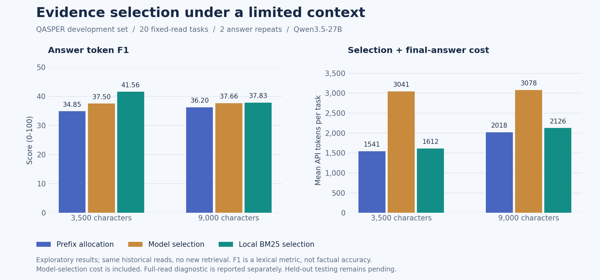

# 实验 001：证据台账为何失效，应该让模型抄原文还是选地址？

日期：2026-11-04。先写计划并快速验证，再决定是否扩大。下列首轮安排在调用模型前记录。

## 问题与假设

早期运行曾出现已读训练证据在写作时丢失。上一轮新增台账后，QASPER dev20-v2 仅 2/20 个任务固定了证据。逐条轨迹审计进一步发现：模型并非没有尝试登记，而是抄写原文时改变换行，触发严格子串校验；重试又丢失错误反馈。

H1：让模型返回已读证据 ID 和行号，由程序提取原文，能提高登记有效率并减少输出成本。保留资料归属、已读范围和长度检查，不能放宽到接受模型改写的证据。

H2：如果登记可靠，在相同已读内容下，选择的证据能改善紧张上下文预算下的回答。H1 成立不代表 H2 成立。

依据：[Anthropic 工具设计](https://www.anthropic.com/research/writing-tools-for-agents)强调真实轨迹、工具接口与上下文效率；[Is Grep All You Need?](https://arxiv.org/html/2605.15184v1)说明结果交付影响端到端表现；[HiEviDR-Bench](https://arxiv.org/html/2607.25151)区分证据定位、引用与断言支持。以下是针对本项目的工程假设，不宣称新的通用算法。

## 首轮安排

1. 审计现有 20 个台账任务，分类错误、重复提示和用量，不重新调用模型。
2. 按旧协议任务顺序选前 8 个开发任务，固定其已有回读，不按答案分数挑题。
3. 相同问题和带行号原文，比较 quote（复制连续原文）与 lines（选择行号）；每种一次，不重试，不访问 gold，不进行新搜索。使用 Qwen3.5-27B、temperature=0.1、非思考模式。
4. 分开记录接口有效、非空登记、原文地址合法与语义支持。空选择可以合法，不能冒充找到证据。
5. 若 lines 至少 7/8 次接口有效、优于 quote，且没有越界/跨论文证据被接受，再开展固定回读的回答实验。此门槛仅用于决定是否投入下一轮，不能作为显著性检验。

## 扩展条件

回答实验比较当前均分前缀、选择后证据和完整已读内容诊断条件。紧预算 3,500 字符与常规 9,000 字符分开报告；完整内容条件不用于同预算优劣结论。选择调用成本全部记录，不能只报告最终生成成本。

实验仍使用开发集，未使用测试集；单论文试验只能检验局部接口/保留机制。若结果不支持 H2，保留负结果并调整设计，不直接推广到跨论文或完整检索流程。

## 当前待办

- [x] 保存可复现轨迹审计。
- [x] 完成 8 题接口对照。
- [x] 根据预设条件决定是否扩大。
- [x] 记录支持与反对假设的证据、成本和下一步。

## 首轮结果与扩展决策

历史审计：20 个任务共有 77 次专用 pin 调用，合计 147,041 tokens；72 次因非连续原文失败，3 次因摘录过长失败，仅 2 次成功。在 85 个尝试登记的条目中，80 个只需规范化空白即可在原文定位，但当前程序正确地拒绝了改写后的文本。16 个任务的多次重试提示完全相同，错误反馈被重建提示覆盖。故此前仅用“预算不足”解释低使用率是不充分的；重复失败先消耗了预算。

| 固定回读的 8 题接口试验 | 接口有效 | 非空登记 | 总 tokens | 输出 tokens |
|---|---:|---:|---:|---:|
| quote：复制连续原文 | 4/8 | 3/8 | 10,888 | 701 |
| lines：返回原文行号 | 8/8 | 7/8 | 10,927 | 588 |

有 1 题历史回读为空，两种方法均合法返回空选择。两种方法读取相同问题与带行号文本；都不重试。lines 没有减少本轮总 token，但消除了这 8 题中的复制校验失败。此结果只支持进入下一轮，不证明语义选择正确。

扩展使用旧协议顺序的全部 20 个 Grep 开发任务，固定原来的回读内容。先做一次 lines 选择，再对每题执行 5 种写作条件、各重复 2 次，共 200 次回答：prefix-3500、selected-3500、prefix-9000、selected-9000、full。选择失败或为空时退回 prefix 并计入选择成本。主要比较预先固定为 selected-3500 减 prefix-3500；9,000 字符和 full 为边界诊断。以任务为单位计算配对差异及 bootstrap 区间，不能把同题重复当独立样本。

20 题选择阶段为 19/20 接口有效、18/20 非空；1 次选择过长被拒、1 次没有原始回读。失败保留，不另挑题。选择用量 42,104 tokens。

首个 `pilot8` 启动未加载父目录的凭据配置，16 条本地 Unavailable 记录均未发出模型请求；该目录保留。配置补齐后整轮新建 `pilot8-configured`，上表来自该轮。

## 第二轮后的新假设（先记录，再运行）

第二轮 selected-3500 的 F1 为 37.50，prefix-3500 为 34.85；配对差异的任务 bootstrap 95% 区间为 [-2.47, +9.06] 个百分点，跨零。计入选择调用后，平均 token 从 1,541 增至 3,041.3。因此尚不把额外模型筛选加入主流程。

增加一个廉价对照：在完全相同的已读内容内，每 2 行起一个最多 4 行的窗口，以字段问题做 BM25 排序，按字段轮流装入互不重叠窗口，严格限制为同样的 3,500/9,000 字符上限；不读取新资料，不调用选择模型。该算法与参数在新运行前确定，未依据 gold 调整窗口或排序。复用第二轮全部 5 条对照，不重挑基线。此轮检查“问题相关的片段选取是否值得继续”，也检查额外模型调用是否有必要。

## 固定回读结果与解释



每行 20 题 × 2 次回答，共 40 次，全部完成。F1 乘以 100 展示，不是事实正确率。模型选择每题仅执行一次，再用于多个写作条件；下表的单次流程成本仍为每个回答加上完整选择费用。

| 上下文策略 | 证据 JSON 上限（字符） | 答案 token F1 | 平均写作 tokens | 平均选择＋写作 tokens |
|---|---:|---:|---:|---:|
| 均分前缀 | 3,500 | 34.85 | 1,541.0 | 1,541.0 |
| 模型选择行号 | 3,500 | 37.50 | 936.1 | 3,041.3 |
| 已读窗口 BM25 排序 | 3,500 | 41.56 | 1,612.5 | 1,612.5 |
| 均分前缀 | 9,000 | 36.20 | 2,017.7 | 2,017.7 |
| 模型选择行号 | 9,000 | 37.66 | 973.2 | 3,078.4 |
| 已读窗口 BM25 排序 | 9,000 | 37.83 | 2,125.5 | 2,125.5 |
| 完整已读内容（诊断） | 按内容扩展 | 36.20 | 2,023.5 | 2,023.5 |

- 模型选择在 3,500 字符下的差异为 +2.65 个百分点，任务级 bootstrap 95% 区间 [-2.47, +9.06]；总调用成本约增加 97.4%。**暂不将额外模型筛选接入默认流程。**
- BM25 选择在 3,500 字符下为 +6.70 个百分点，区间 [+0.91, +14.52]，9 题提高、3 题下降、8 题相同；token 增加约 4.6%。这是新的开发假设，值得在新任务上复核。
- BM25 选择在 9,000 字符下仅 +1.63 个百分点，区间 [-1.94, +6.14]。本轮完整回读诊断与 9,000 字符前缀得分相同，说明原上下文足够宽时，压缩改进的空间可能有限。
- 区间来自已参与开发的 20 题，未作多重比较校正；两个最大收益题约贡献净提升的 73%。不能据此宣称已得到普遍、稳定的性能提升。
- 第一轮 200 次回答中，100 对同条件重复有 94 对答案完全相同。它们不能当作 200 个独立任务。需要新的题目、不同轨迹与后续跨模型检查。
- 保留更多 gold 段落字符并不必然提高答案 F1。3,500 字符下，前缀/模型选择/BM25 的已读 gold 字符留存代理分别为 66.31%/33.14%/58.52%，只在 15 个原本读到标注证据的任务上有定义。该指标用于定位文字损失，不认证足够支持或语义正确。

## 案例检查与新的问题

以下是助手对开发轨迹的检查，未冒充独立人工核验：

- `qasper-31d695ba855d821d3e5cdb7bea638c7dbb7c87c7`：前缀回答把通用 Transformer 背景当成本论文结构；模型选择定位到该论文 118–122 行的 GRU 架构，回答随之改变。这支持进一步研究“背景内容与作者方法”的区分。
- `qasper-2e89ebd2e4008c67bb2413699589ee55f59c4f36`：问 Siamese 网络如何训练，模型选择留下具体训练超参数，舍弃目标函数概述，F1 反而下降。地址合法并不保证选中了问题要求的层次。
- `qasper-7ee5c45b127fb284a4a9e72bb9b980a602f7445a`：BM25 条件的 F1 下降伴随措辞变化，两种回答均指向同一个模型与训练集。这说明需要语义审核，不能将全部词面差异解释为质量差异。
- `qasper-220d11a03897d85af91ec88a9b502815c7d2b6f3` 是 BM25 最大收益题；其答案引用引言中的一般假设。这个假设是否充分解释题目所问的英语实验现象，还需核验。**高 F1 不能替代对证据语境的检查。**

## 已落地与暂缓的部分

已落地：冻结历史回读的实验工具、行号选择校验、无额外模型调用的窗口排序对照、独立评分及按任务配对分析。生成过程从未读取 gold；输出引用必须来自实际展示的已读窗口。

同时修复旧台账的重试控制：同一批已读证据最多尝试两次专用登记；第二次保留明确错误反馈；超过上限后记录 rejected 状态并继续研究/交付，避免相同失败反复消耗预算。格式修复只接收属于最终报告的错误，避免把台账错误混入报告修复。新增失败注入测试验证此行为，**没有将该修复宣称为已获得端到端质量提升**。

本轮最终离线测试：127 passed。此次没有修改默认工作台的检索或写作策略，也没有开启留出测试。实验策略保留在独立实验命令中。

## 用量与复现

实际共 316 次模型调用、513,098 tokens，其中输入 485,880、输出 27,218；没有缺失用量。此数字按实际请求累加，选择阶段只算一次。与表中“单次假想流程”的费用口径不同。没有新 embedding 调用，没有训练。本机原始文件保留，仓库只发布协议、哈希、统计和图表：[结果清单](../results/evidence-selection-v1.json)。

在 `backend` 下设置 `PYTHONPATH=app`。以下路径都是本地参数；凭据配置不写入实验输出：

```powershell
python -m research_backend.benchmarks.evidence_replay audit --prior <旧运行目录> --out <新目录>/audit.json
python -m research_backend.benchmarks.evidence_replay select --inputs <dev/inputs.json> --prior <旧运行目录> --source-method grep-ledger --limit 8 --out <新目录>/pilot --env-file <本地.env.research>
python -m research_backend.benchmarks.evidence_replay select --inputs <dev/inputs.json> --prior <旧运行目录> --source-method grep --methods lines --limit 20 --out <新目录>/selections --env-file <本地.env.research>
python -m research_backend.benchmarks.answer_replay --inputs <dev/inputs.json> --prior <旧运行目录> --selections <新目录>/selections --out <新目录>/answers --env-file <本地.env.research>
python -m research_backend.benchmarks.score_replay --inputs <dev/inputs.json> --gold <dev/gold.json> --run <新目录>/answers
python -m research_backend.benchmarks.answer_replay --inputs <dev/inputs.json> --prior <旧运行目录> --selections <新目录>/selections --policies lexical --out <新目录>/lexical --env-file <本地.env.research>
python -m research_backend.benchmarks.score_replay --inputs <dev/inputs.json> --gold <dev/gold.json> --run <新目录>/lexical --reference <新目录>/answers
```

旧运行需含 `protocol.json` 与对应方法每题的 `prediction.json`；脚本校验原文与冻结数据一致。重现本次精确输入还需本机保留的旧运行；另行生成历史轨迹会形成新实验，不保证同一分数。绘图脚本 `backend/scripts/plot_evidence_experiment.py` 读取已发布汇总，另需安装 matplotlib。

## 下一轮清单与进入条件

1. 在新的开发题上复核窗口排序，固定本轮参数；加入完整 Grep 流程时，记录策略真正作用的收尾次数，避免“组件存在但没有使用”。
2. 抽查提高、下降、未变化三组的语义支持，重点区分背景假设、作者方法、实验设置和结论。若 F1 提高主要来自措辞匹配，不把它当机制成功。
3. 若效果延续，再检验多论文多字段调度，并与多轮混合 RAG/公开文件式 Agent 在统一条件下比较。记录每项方法适配与成本，不直接套用论文分数。
4. 暂不继续扩大额外模型筛选方案；若要重试，先验证能否并入已有决策轮，避免增加一次完整调用。
