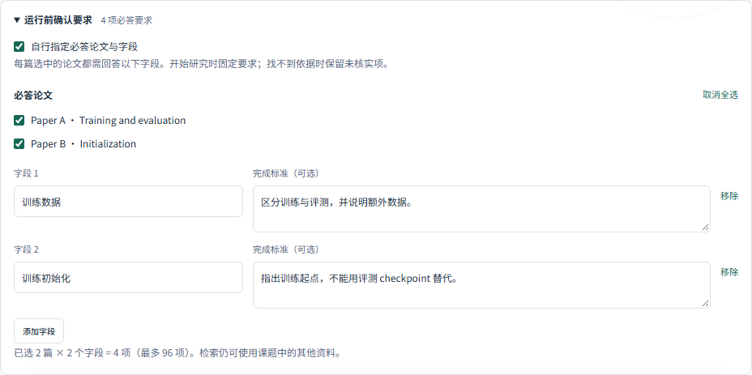

# 运行前要求确认与故障矩阵 v1

2026-11-08。完成工作台要求编辑器、独立故障评测入口和收尾反馈修复。软件验证与真实研究质量分别报告。

## 用户现在可以做什么

在输入框上方展开“运行前确认要求”，选择必答论文，添加字段及完成标准。每篇选中论文回答同一组字段，总数最多 96 项。点击开始研究时，要求通过 `required_fields` 进入生产 API 和模型上下文，运行后的字段卡可展开查看完成标准。

空字段、重复名称、关闭字段检查、资料失效或超出上限会拦截提交。切换课题或创建全新研究会清空要求，避免跨课题误用。必答论文不构成检索访问范围：模型仍可检索当前课题的其他资料。未自行指定时保留模型自动提取，并明确提示可能遗漏。



截图来自真实前端与拦截 API 的测试。独立后端回归验证要求确实进入首次模型调用并随 run 持久化，截图不代表真实模型研究结果。

## 可单独运行的故障评测

在仓库根目录使用已安装核心依赖与 pytest 的环境执行：

```bash
python scripts/eval_agent_faults.py --out test-results/agent-faults-new
```

输出目录必须不存在；生成 `manifest.json`、`junit.xml`、`pytest.log`、`summary.json` 和 `report.md`。17 个场景包含 6 个契约检查和 11 个生产 Runtime 路径，覆盖缺证据、跨论文证据、旧核验、格式错误、无进展、预算、未知用量、服务失败、提供商超时、取消和访问隔离。

运行记录来自实际存储状态，包含状态、停止原因、未解决字段、报告是否保留、已知用量与事件类型。契约检查明确标为不执行 Runtime；取消的字段停止原因可能为 null，以运行的 `cancelled` 状态及事件为准。提供商超时用异常注入，不冒充真实时间调度或负载测试。

失败、跳过、缺失和重复结果均不能成为通过；缺少必要运行观察记录也会失败。汇总器自身有缺失、跳过、重复、错误退出及虚假语义成功的回归。所有模型响应都是替代模型，语义准确率保持 null。

本次 [17 项场景结果](execution-v1/faults.md) · [机器记录](execution-v1/faults.json) · [代码哈希](execution-v1/fault-source-manifest.json)。CI 的每个后端环境会执行并上传故障矩阵。

## 实际发现并修复的错误

新的真实论文任务连续触发报告校验失败。检查轨迹发现，收尾时 `final_context` 从原文重建上下文，丢失上一次工具错误，模型无法看到具体修改要求。

现在保留最多 1,600 字符的报告校验反馈，明确与原文证据分开，并计入收尾上下文预算；不会放宽引用校验或把失败草稿改成有效结论。完整回归模拟一次无引用声明被拒绝、下一轮强制收尾，检查错误路径与原文均仍可见。

真实复跑仍失败：反馈已传入，但模型又产生其他无引用分析。此修复证明程序错误已被覆盖，不能宣称研究任务成功率提高。两次真实调用及下一步见 [开发案例诊断](RESEARCH_JUDGMENT_DEV001.md)。

## 本地验证

| 检查 | 结果 |
|---|---|
| Windows / Python 3.13 完整依赖 | 240 passed，0 skipped |
| 前端要求构造检查 / Node 24 | 5 passed |
| 故障矩阵 | 17 passed，语义准确率 null |
| TypeScript 与生产构建 | 通过；原有分析图表 558.01 kB 警告保留 |
| 浏览器交互 | 桌面、390×844、浅色与深色；检查 4 项显式要求的请求、非法提交拦截和课题切换清空 |

[机器验证记录](execution-v1/validation.json) · [浏览器记录](execution-v1/ui-validation.json)。本地检查不代替尚未完成的对应提交 CI。

浏览器脚本 `scripts/smoke_requirements_ui.py` 需要独立开发环境的 Playwright 与 Chromium，或 `--browser-path` 指定本机浏览器；不增加应用依赖。前端检查命令为 `npm test`，使用 Node 24；运行条件见 [安装说明](../REPRODUCIBILITY.md)。
