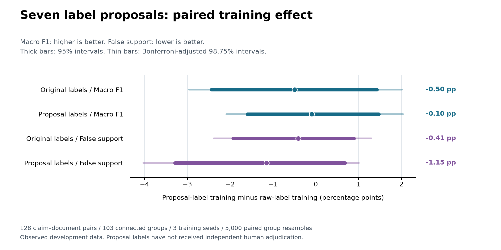

# SciFact 第三轮：七条训练标签建议的受控干预

**结论：本轮没有观察到稳定改善。** 在其余设置相同的六次新训练中，仅替换 535 对训练样本中的 7 条标签，原始评分口径的三种子平均 Macro F1 从 **0.7481 到 0.7432**，非支持误判支持率从 **15.64% 到 15.23%**。两项配对区间均跨 0；采用公开更正建议评分也没有改变这一判断。

这说明这 7 条干预尚不足以解决当前错误支持问题，**不证明数据质量无关，也不证明公开建议已经成为真值**。评估数据已在第二轮被观察，本轮属于开发诊断。独立人工仲裁尚未完成，不能把结果包装成清洗数据后的正式测试提升。

## 实验实际做了什么

2026-11-06，在同一张 RTX A5000 上完成全部六个条件，产生 **1,446/1,446 条新预测，零缺失**。另使用第二轮的 482 条归档基线预测作参考，未计为本轮新运行。

| 项目 | 固定设置 |
|---|---|
| 两个训练条件 | raw：原始 535 对；proposed：同样 535 对，仅改 7 个标签 |
| 模型与精度 | Qwen2.5-7B-Instruct，BF16 底座与 LoRA；没有全量微调或量化回退 |
| LoRA | q_proj/v_proj，rank 8，alpha 16，dropout 0.05；2,523,136 个可训练参数 |
| 优化 | AdamW，学习率 2e-4，weight decay 0.01，8 步 warmup 后线性衰减，梯度裁剪 1 |
| 预算 | 每次 128 步，batch 1 × 累积 4，共读取 512 对；最大 1536 tokens，不截断 |
| 种子 | 20261106、20261107、20261108；两个条件逐种子使用相同样本顺序 |
| 实际干预曝光 | 三个种子分别遇到 6、6、7 条被修改标签 |
| 评分样本 | 校准 65 对；已观察评估 128 对、103 个连接组；合成挑战 16 对；空证据 32 对 |
| 原有参考 | 7B BF16 原模型；Bespoke-MiniCheck-7B BF16（二分类专用，不计算其三分类 F1） |

更正来自 [Sylvestre 的公开 SciFact 审计](https://aclanthology.org/2026.bionlp-1.9.pdf)，固定版本、文件哈希和 CC BY 4.0 归属见[来源清单](../dataset-manifests/scifact-audit-bionlp2026/provenance.json)。训练干预只涉及 claim 164、165、79、1297、576、933、1036 的指定文档对；其他字段、样本数量、提示、顺序和训练函数不变。

代码与协议冻结于 `e3d4108181568881824e2e6fdc9021c8f974e778`；实际数据清单在 GPU 执行前由 `b8628ac` 提交。参见[运行前协议](../experiments/SCIFACT_LABEL_ABLATION_PILOT.md)、[数据清单](../dataset-manifests/scifact-label-ablation-v1.json)和[标签干预明细](scifact-label-ablation-v1/correction-overlay.json)。

## 主要结果：同一评分口径内比较训练条件

下表均为三个种子的算术平均。错误支持率分母是对应口径下的全部非支持样本，越低越好；支持精确率和支持召回不能互相替代。

| 评分口径 | 训练条件 | Macro F1 | 支持精确率 | 支持召回 | 错误支持率 |
|---|---|---:|---:|---:|---:|
| 原始标签 | raw | 0.7481 | 76.34% | 86.52% | 15.64% |
| 原始标签 | proposed | 0.7432 | 76.06% | 82.98% | 15.23% |
| 公开更正建议 | raw | 0.7510 | 71.32% | 92.68% | 17.62% |
| 公开更正建议 | proposed | 0.7500 | 72.16% | 90.24% | 16.48% |

“公开更正建议”口径替换 1 条校准标签和 6 条评估标签，仍保留相同样本。它不是经过独立双人仲裁的新 gold。原始口径有 47 个支持、81 个非支持样本；更正建议口径为 41 个支持、87 个非支持样本。

主要差值为 proposed 减 raw，在 103 个论文/声明连接组上配对 bootstrap 5,000 次。两个指标 × 两种口径共四项比较，按预定方案同时报告 95% 与 Bonferroni 校正后的 98.75% 区间。种子按均值计算，不把 128 对样本膨胀成 384 对独立样本。

| 口径 / 指标 | 差值（pp） | 95% 区间（pp） | 校正 98.75% 区间（pp） |
|---|---:|---:|---:|
| 原始 / Macro F1 | −0.50 | [−2.43, +1.42] | [−2.96, +2.01] |
| 原始 / 错误支持率 | −0.41 | [−1.93, +0.89] | [−2.38, +1.30] |
| 更正建议 / Macro F1 | −0.10 | [−1.60, +1.47] | [−2.09, +2.03] |
| 更正建议 / 错误支持率 | −1.15 | [−3.29, +0.69] | [−4.03, +1.00] |

[](scifact-label-ablation-v1/paired-effects.svg)

四项区间都跨 0，不能宣称稳定收益；这也不是证明两个条件等效的等效性检验。区间以这三个已经训练好的种子为条件，没有充分估计训练随机性的总体方差。

## 全部种子与具体变化

| 种子 | raw 原始 F1 | proposed 原始 F1 | raw 更正建议 F1 | proposed 更正建议 F1 | 更正建议口径下消除 / 新增错误支持 |
|---|---:|---:|---:|---:|---:|
| 20261106 | 0.7426 | 0.7426 | 0.7484 | 0.7484 | 0 / 0 |
| 20261107 | 0.7458 | 0.7312 | 0.7465 | 0.7385 | 3 / 1 |
| 20261108 | 0.7560 | 0.7557 | 0.7582 | 0.7632 | 1 / 0 |

第一对的 128 条评估分类完全相同，但适配器确实更新且文件哈希不同，不能将相同分数解释成没有训练。另两对分别改变 8、5 条判断，收益与损失同时存在。

例如 `official-dev-1368-2425364` 在后两个种子中从 supported 变为 contradicted，而公开建议标签为 insufficient：它减少了二分类错误支持，**三分类判断仍然错误**。`official-dev-475-18678095` 则在后两个种子中把原本正确的 supported 改成 insufficient，损失了支持召回。完整变化与 ID 见[逐对诊断](scifact-label-ablation-v1/paired-case-diagnostics.json)，这些标签依赖的变化不是新增人工语义判定。

同一种子与第二轮旧适配器相比，本轮 fresh raw 的评估分类分别有 0、2、1 条不同；少量非逐位一致性仍存在。主要对照全部使用本轮重新训练的 raw，不从历史运行择优拼接，也不把极小点估计变化单独解释为机制收益。

## 阈值与强参考模型

阈值只从 65 对校准数据选择：在经验错误支持率不超过 5% 的候选中最大化支持召回。两个校准口径此次选出相同阈值。以下是原始评估标签下的结果；“校准阈值”是另一个二分类决策，不替换默认三分类预测。

| 方法 / 决策 | 支持精确率 | 支持召回 | 错误支持率 |
|---|---:|---:|---:|
| raw 三种子 / 默认 | 76.34% | 86.52% | 15.64% |
| proposed 三种子 / 默认 | 76.06% | 82.98% | 15.23% |
| raw 三种子 / 校准阈值 | 79.54% | 82.27% | 12.35% |
| proposed 三种子 / 校准阈值 | 79.56% | 79.43% | 11.93% |
| 7B 原模型 / 默认，归档 | 80.00% | 76.60% | 11.11% |
| MiniCheck / 默认，归档 | 91.89% | 72.34% | 3.70% |
| MiniCheck / 校准阈值，归档 | 89.74% | 74.47% | 4.94% |

raw/proposed 在校准阈值下接受比例分别为 38.02% / 36.72%。采用公开更正建议评分时，校准阈值下错误支持率为 13.79% / 13.41%，也未达到 5%。小校准集的经验约束并非总体保证，不用评估结果反选阈值。

MiniCheck 在这里仍是有竞争力的专用二分类参考；其更正建议口径默认支持精确率为 89.19%，错误支持率为 4.60%。但它的支持召回、任务输出格式与三分类 LoRA 不同，不能直接比较三分类 F1，也没有通过此实验排除其训练数据暴露差异。

六个新条件在 16 对合成挑战上均为三分类 F1 0.8216，在 32 对空证据上均无错误支持。归档 MiniCheck 空证据仍为 2/32 错误支持。小型合成诊断不替代自然文本评估，也不足以授权自动裁决。

## 文档 597 敏感性情景

公开建议中 claim 597 的文档范围不明确，未批量套用。额外情景只把 `597/12779444` 视为 insufficient，另外两篇文档保持原标签。该情景下 raw/proposed 平均 F1 为 **0.7443 / 0.7432**，错误支持率为 **18.56% / 17.42%**；只报告点估计，未追加主要显著性检验。人工仲裁完成前不将其并入默认更正口径。

## 资源、复现与实际边界

正式运行从 UTC 12:59:29 到 13:33:13，耗时 **33 分 44 秒**，包括启动核验、加载、训练、重载和预测，独立评分随后执行。六次纯训练共约 21 分 22 秒，每次约 213–214 秒；推理计时合计约 171 秒。PyTorch 分配峰值最高 **15,239 MiB**，保留峰值最高 **16,472 MiB**，不等同于驱动报告的整卡占用。运行后 GPU 已释放至空闲状态，没有云模型调用费用。

训练代码不读取 `labels-*.json`，模型消息仅包含问题、声明和证据。启动完整性检查还会对更正 overlay 和归档参考文件做字节哈希，但不解析其中的评估标签、不将其送入模型；这是模型输入与评分逻辑隔离，并非操作系统文件权限隔离。任何后续更改文件或代码都会触发冻结哈希检查。

第一次 SSH 后台启动随会话结束，尚未创建正式 protocol、训练记录或预测；空日志保留。随后保持 SSH 连接执行相同冻结版本，六个正式条件全部完成，没有根据分数选择性重跑。

环境、适配器文件核验和耗时见 [environment.json](scifact-label-ablation-v1/environment.json)；全部参数更新与 loss 见 [training.json](scifact-label-ablation-v1/training.json)。服务器文件位于：

```text
D:\Ding\data\scifact\label-ablation-v1\
D:\Ding\results\scifact-label-ablation-v1\run-001\
```

适配器与数据留在服务器，仓库发布评分必要的标签、预测、训练元数据与日志，不提交模型权重或论文语料。无 GPU 的独立复核命令：

```powershell
python scripts/audit_verifier_labels.py --bootstrap
```

该程序用独立实现重算所有视图的二分类指标、Macro F1、校准阈值、主要配对差值和区间，同时检查哈希、重复记录、样本范围与训练预算。完整[原始预测](scifact-label-ablation-v1/predictions.jsonl)、[机器结果](scifact-label-ablation-v1/analysis.json)与[归档清单](scifact-label-ablation-v1/artifact-manifest.json)可离线审计。绘图脚本为 `scripts/plot_verifier_labels.py`，可选绘图库版本单独记在 `plot-environment.json`，未改变 GPU 环境。

完整训练复现需在冻结代码 `e3d4108` 的独立 checkout 中使用原 v2 数据与已核验模型，输出到新目录：

```bash
export PYTHONPATH=backend/app
python -m research_backend.benchmarks.verifier_labels prepare \
  --old-data /mnt/d/Ding/data/scifact/verifier-scale-v2-003 \
  --old-results docs/results/scifact-verifier-scale-v2 \
  --corrections docs/dataset-manifests/scifact-audit-bionlp2026 \
  --out /mnt/d/Ding/data/scifact/label-ablation-reproduction
python -m research_backend.benchmarks.verifier_labels run \
  --plan-dir /mnt/d/Ding/data/scifact/label-ablation-reproduction \
  --out /mnt/d/Ding/results/label-ablation-reproduction
python -m research_backend.benchmarks.verifier_labels score \
  --plan-dir /mnt/d/Ding/data/scifact/label-ablation-reproduction \
  --run-dir /mnt/d/Ding/results/label-ablation-reproduction \
  --out /mnt/d/Ding/results/label-ablation-reproduction/analysis.json
```

工程验证为 Windows 完整环境 **186 passed**，服务器 Ubuntu 核心环境 **173 passed / 13 skipped**（可选依赖）；对应 XML 已归档。独立统计复算通过。仓库的 CI 已加入本轮审计命令，托管执行状态以相应提交的 Actions 为准。

## 下一步的依据

本轮按预定的六次训练与统一评分结束，不追加训练去追逐正结果。优先完成已准备的 83 对盲审样本的独立人工标注与分歧仲裁，再建立与科研 Agent 目标领域一致的自然声明评估集。只有错误归因确认了稳定、可训练的模式，才进入已规划的困难反例增广对照。

对“是不是数据问题”的准确回答是：**标签质量会影响我们如何判断模型，但仅修这 7 条训练标签没有产生可确认的改善。** 例如同一 raw 模型的支持精确率在原始与公开建议口径下是 76.34% 与 71.32%，说明评价标签值得优先仲裁。不能据此断言全部差距来自数据，也不能据此证明继续增加参数或训练步数会有效。

本轮仍只测量给定摘要下的声明分类，不测完整 Agent 的检索、补读、报告或幻觉率；QASPER 200 题保留集未使用。[后续数据实验方案](../experiments/VERIFIER_DATA_EXPERIMENT_PLAN.md)中的人工仲裁和目标域评估尚未完成。
